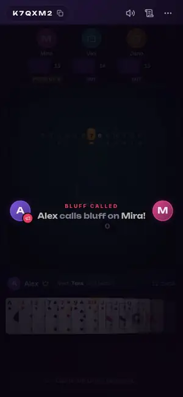
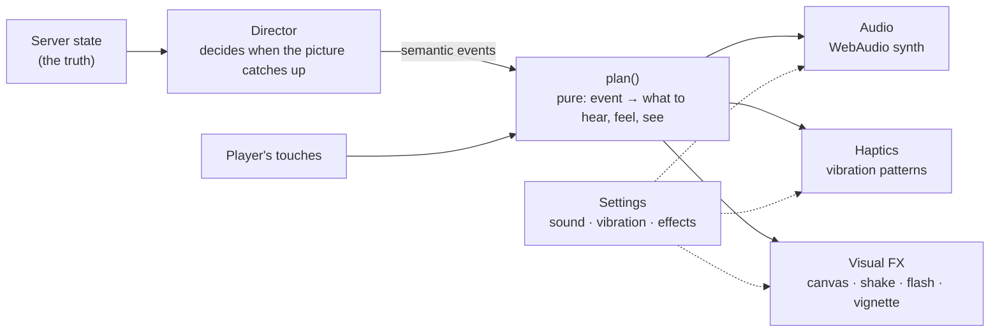

# Game feel

How Leery makes a card game feel like a game: what happens when you tap, throw, call and get caught — and how to
add to it without breaking it.

  

## Principles

- **Answer every touch within a frame.** Cards and buttons press in the instant a finger lands, and a card you play
  leaves your hand before the server has replied. The request follows; the picture never waits for it.
- **Weight and consequence.** Cards slap down with a sound, a ring and a few specks of dust that grow with how many
  you play. A bluff being caught is the loudest thing in the game: the screen shakes, the stamp slams, the liar's
  seat reacts and the pile sweeps across the table to them.
- **Suspense is a feature.** The last card of a reveal is held back for a beat of drumroll before it turns over.
  Time running out raises a heartbeat and closes a red vignette in from the edges. Everything else stays calm so these
  moments can land.
- **One story, three channels.** Every moment is described once — as a semantic event — and turned into *sound*,
  *vibration* and *visual effects* together, so they can never drift apart.
- **Restraint, and a way out.** Haptics are short and never nag. Sound, vibration and screen effects each have a
  switch in **Settings**; "Reduced" effects removes shake, flashes, particles and every decorative animation and keeps
  only what's needed to follow the game, and "Auto" follows the device's reduce-motion setting. (`<html data-effects>`
  carries the effective state, so the stylesheet and framer-motion obey it as well as the canvas.)
- **Free to run.** No audio files, no image sprites, nothing to download: sounds are synthesised, effects are drawn on
  one canvas. Effects are the first thing to give when a phone struggles (see [Performance](#performance)).

## How it fits together

| Piece | Where | What it does |
| --- | --- | --- |
| **Vocabulary & plan** | `src/lib/feel/` | `FeelEvent` (`card.select`, `call`, `reveal.verdict`, `pickup.land`, …) and `plan()`, a pure function that maps one event to its cues, haptic and FX steps. `feel.emit(event, delay?)` runs the plan. |
| **Director** | `src/components/game/director/` | Compares successive server snapshots (`detectEvents`), emits feel events at the right moment, and applies *presentation holds* so the picture tells the story in order (the pile is emptied on the server the instant a bluff is called, but stays on screen until the cards have travelled). |
| **Reveal choreography** | `src/components/game/revealTimeline.ts` | The timeline of a reveal (below). Pinned by unit tests. |
| **Audio** | `src/lib/sound/` | A small WebAudio synth: 32 cues, a heartbeat loop (and a barely-there room-tone loop that the game doesn't use yet), one master chain (gain → compressor → soft clipper) with a shared reverb, equal-power panning by seat, a 24-voice budget. Tonal centre D (minor pentatonic for tension, major for resolution), so the cues sit together. |
| **Haptics** | `src/lib/haptics.ts` | `navigator.vibrate` patterns on Android; on iOS (no Vibration API) tap-like events borrow the light tick of a `switch` input. |
| **Visual FX** | `src/lib/fx/`, `src/components/fx/` | One pooled-particle canvas (sparks, dust, embers, confetti, smoke, glints), rings, a trauma-based screen shake, flashes and a vignette; a frame-rate governor scales it down on slow devices. |
| **Preferences & tips** | `src/lib/prefs.ts`, `src/lib/hints.ts`, `src/components/shell/` | Settings dialog and the three first-time tips (pick, call, drag), each shown once. |

### The reveal

When a bluff is called the room is held in `reveal` for 4.5 s by the server, and the whole story has to fit — including
for someone who joins half-way through. Times are in milliseconds from the call (two cards shown):

| t | What happens |
| --- | --- |
| 0 | The call lands: shake, red flash, caller and accused face off. |
| 430 | "*Mira* claimed 2 × Sevens". |
| 700 | The cards rise out of the pile, face-down. |
| 1250 → | They turn over one by one, 330 ms apart. The last one waits 380 ms longer, under a drumroll. |
| 2510 | **BLUFF!** (or **HONEST**) slams down. |
| 2930 | The cards sweep to whoever has to pick them up; the pile follows. |
| 3130 | The scrim lifts so the table is visible again. |
| 3570 | They land: counts tick up and the seat reacts. |

A player who arrives mid-reveal gets the same story, compressed to still finish before the server moves on
(`revealSkip`). With reduced effects the motion is minimal but the order is the same.

## Trying it

The labs run without a backend: `npm run dev:ui`, then

| Open | To |
| --- | --- |
| `/dev/audio.html` | Audition every cue (with `n`, level, pan and duration sliders), whole scenarios — a reveal, the last three seconds, the deal — and the heartbeat and ambience loops. Toggles for sound and vibration. |
| `/dev/fx.html` | Fire every effect with every knob; click anywhere to place it. A heads-up display shows live particle counts and frame timing. |
| `/dev/game.html?sim=1` | A scripted game: play cards, get called, pick up the pile, watch the next turn. Add `&reduced=1` (or `=0`) to flip the real Screen effects setting. |
| `/dev/game.html?deal=1` | The opening deal of a brand-new game. |
| `/dev/game.html?state=reveal-bluff` | Any fixture frozen in a state (see `FIXTURE_NAMES`). |

On a phone, serve them over your network (`npx vite --host`, then open the printed address) — vibration and a real
speaker are the point.

## Adding a moment

1. **Name it.** Add a variant to `FeelEvent` in `src/lib/feel/plan.ts` and handle it in `plan()`: which cues, which
   haptic, which FX. Keep it data — no timers, no DOM — and add a case to `tests/unit/feelPlan.test.ts`.
2. **Need a new sound?** Add the name to `Cue` in `src/lib/feel/contract.ts`, write the synth in `src/lib/sound/cues.ts`
   (follow the neighbouring cues: oscillators and noise through the shared bus, in tune with D), audition it in
   `/dev/audio.html`, then run `node scripts/audio-check.mjs`. It renders every cue offline through the same code and
   chain as the game and fails on clipping, DC offset, tails that never end, wrong length, or a cue that's much louder
   or quieter than its neighbours. `--calibrate` suggests per-cue trims.
3. **Fire it.** Call `feel.emit({ type: "…" })` from the component that owns the moment — or, for anything driven by the
   server, add the trigger to `detectEvents` in `director/events.ts` (unit-tested) and let the director emit it.
4. **Check it feels right with effects reduced**, and that it still reads with sound off.

Rules of thumb that came out of tuning it:

- Sounds under ~150 ms for UI, under ~600 ms for impacts; nothing should still be ringing when the next beat arrives.
- Pan by where the thing happens (seat position), not randomly.
- A haptic is a punctuation mark: ≤ 400 ms in total, and never on something that happens many times a second.
- Shake intensity is *trauma* (0–1, squared on the way out): 0.1 is a nudge, 0.9 is the worst moment in the game.

## Performance

A card game is mostly a stack of small animations, so it's easy to make it slow by making them pretty. What's in place:

- Screen shake writes one `transform` to the elements that registered for it — never custom properties on `<html>`,
  which would re-style the whole document every frame.
- Pulses and glows animate `opacity` and `transform` only (no animated `box-shadow`); hand and table components are
  memoised so only what changed re-renders.
- The particle canvas is capped at a device-pixel-ratio of 1.5 and 400 live particles. A **frame governor** watches the
  real gap between frames and, if the device struggles, shrinks the canvas, halves particle counts, then repaints every
  other frame — and climbs back after a couple of comfortable seconds.
- The audio engine is built right after the first frame of the first tap has painted (an `AudioContext` takes tens of
  milliseconds to create), rather than at the moment the finger lifts.
- Opponents' seats re-render only when their own data changes; a countdown with no deadline doesn't tick.
- Only the most recent beats of a burst of old log entries are staged — a phone coming back from the background
  doesn't replay twelve plays at once.

Measure on a production build (`npm run build && npm run preview`) with CPU throttling; the dev build is much slower.

### Small screens

The felt (the green table) shows the rank dial, the banner and the pile, and how tall that is depends on the phone: the
banner wraps on a narrow screen, a 25-card hand takes three rows, eight opponents need two rails above it. The vertical
budget is what the browser leaves you, not the screen size — an iPhone SE in Safari is about 375×553 once the toolbars
are up. After layout the table measures itself and, if the pile would be clipped, steps down one level at a time
(`useFeltFit` in `feltFit.ts`):

1. drop the banner's sub-line · 2. a smaller pile · 3. drop the rank dial · 4. the smallest regular pile ·
5. drop the small label above the banner and the prompt under it · 6. (phones) the pile beside the banner instead of
under it, a thinner felt border, a smaller title and rank chip · 7. (phones) a still smaller pile.

`tests/unit/feltFit.test.ts` pins the order and that `game.css` keeps everything dropped once it is dropped. Check a
change at 320×568, 360×560, 375×553, 390×664 and 390×844 (`/dev/game.html?state=…`): `turn-mine-many` (25 cards),
`eight-players` and `eight-challenge` (the tallest banner on the most crowded table) are the stress cases.

## Tests

| What | How |
| --- | --- |
| Event → cues/haptics/FX mapping | `tests/unit/feelPlan.test.ts` |
| Detecting what happened between two snapshots; holds | `tests/unit/director.test.ts` |
| Reveal timeline fits the server's hold | `tests/unit/revealTimeline.test.ts` |
| What the felt drops, in what order, on a small phone | `tests/unit/feltFit.test.ts` |
| Synth maths, notes, analysis, cue bookkeeping, the facade, when the engine is built | `tests/unit/sound.*.test.ts` |
| Haptic patterns and gating | `tests/unit/haptics.test.ts` |
| Particles, shake, governor, canvas engine | `tests/unit/fx-*.test.ts` |
| Loudness, clipping, tails, length of every cue (headless Chromium) | `node scripts/audio-check.mjs` |
| Drag-to-play, first-time tips, settings against the real engine | `tests/e2e/feel.spec.ts` |
